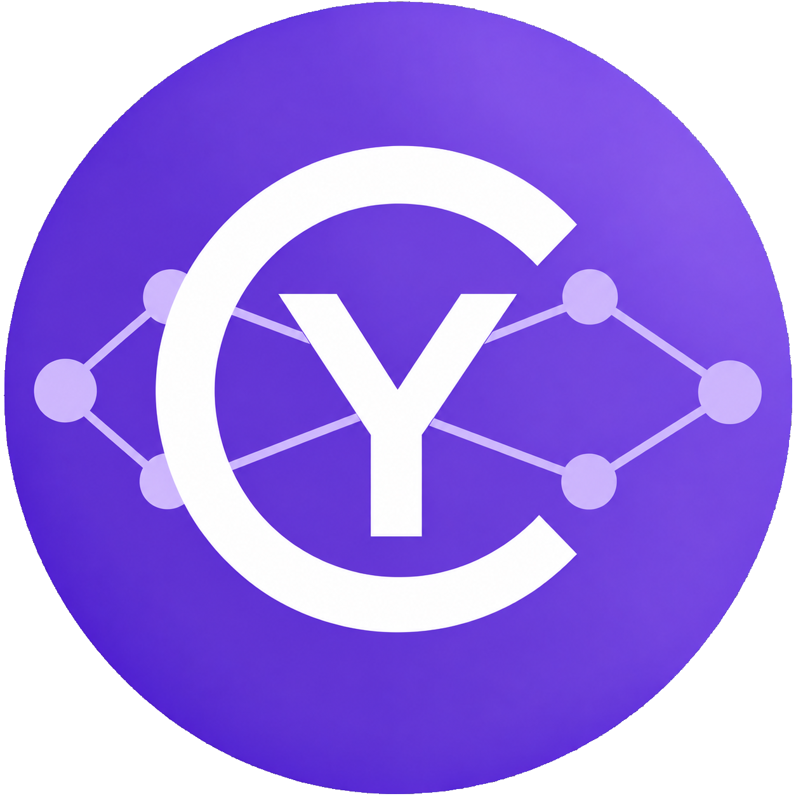
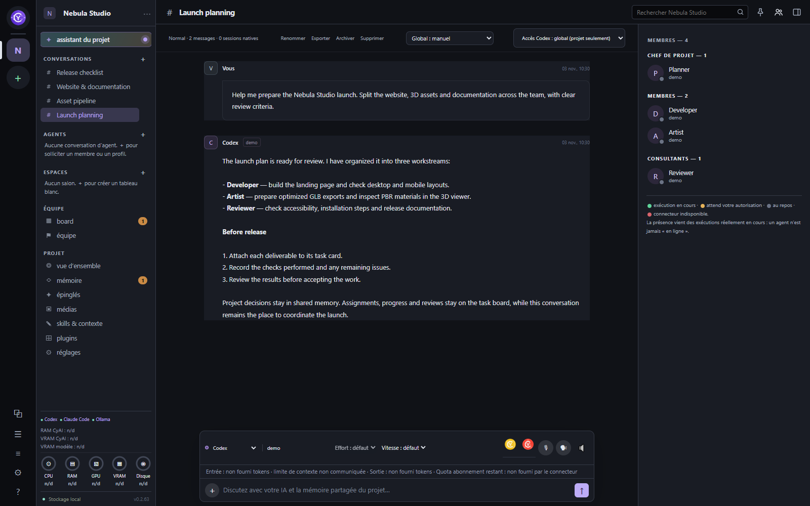
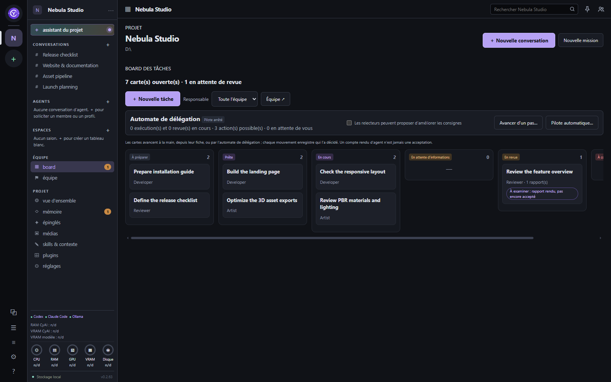
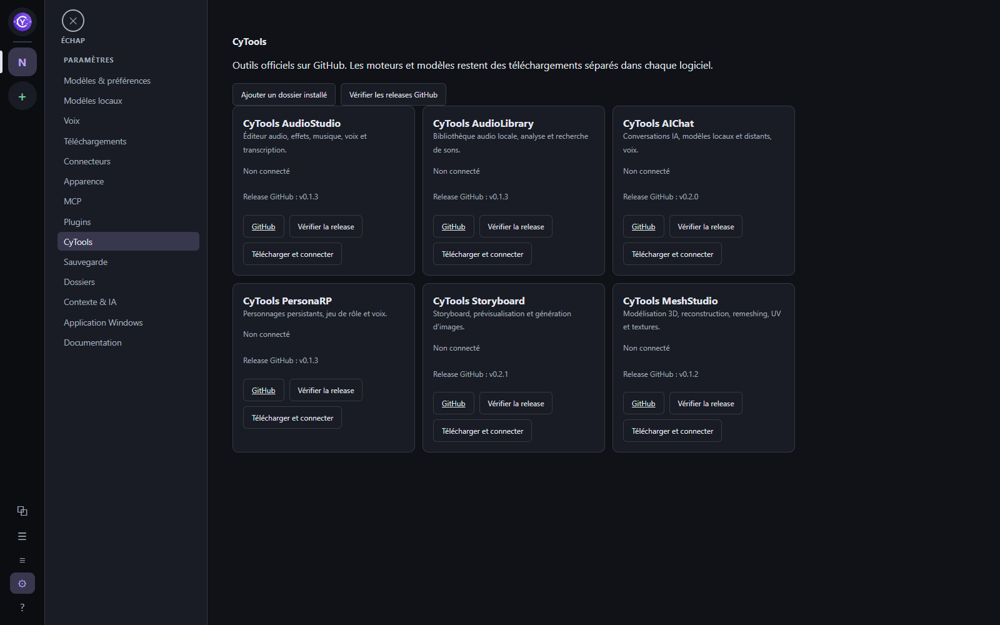

<table width="100%">
  <tr>
    <td width="300" align="left" valign="top">
      <a href="https://mrmybal.github.io/CyAIOrchestrator/Documentation.html#/fr/start">Documentation</a><br>
      <a href="https://github.com/MrMybal/CyAIOrchestrator">Dépôt</a><br>
      <a href="https://github.com/MrMybal/CyAIOrchestrator/issues">Suivi des problèmes</a><br><br>
      <sub>README</sub><br>
      <a href="README.md">English</a> · <a href="README.fr.md">Français</a>
    </td>
    <td width="400" align="center" valign="middle">
      
    </td>
    <td width="300" align="right" valign="top">
      <p><sub>Licence de l'application</sub><br><a href="LICENSE"><strong>AGPL-3.0-only</strong></a></p>
      <p><sub>Version</sub><br><a href="docs/release-0.2.66.fr.md"><strong>0.2.66</strong></a><br><strong>Alpha</strong></p>
      <p><a href="https://github.com/MrMybal/CyAIOrchestrator/releases/download/v0.2.66/CyAIOrchestrator-Setup-0.2.66.exe"><strong>Télécharger</strong></a><br><sub>Windows x64 · installateur</sub></p>
    </td>
  </tr>
</table>

<h1 align="center">CyAI Orchestrator</h1>

Un espace de travail local sous Windows pour utiliser des agents IA sur les fichiers de vos projets. Réunissez conversations, agents réutilisables, contexte partagé, tableaux de tâches et missions en arrière-plan, avec des connecteurs de fournisseurs ou des modèles locaux.

> **Alpha · 0.2.66**
>
> Version destinée aux essais et aux retours. Certaines fonctionnalités peuvent être incomplètes et les parcours peuvent évoluer avant une version stable. Consultez les [notes de version et limitations documentées](docs/release-0.2.66.fr.md), ou [signalez un problème](https://github.com/MrMybal/CyAIOrchestrator/issues).

[](Documentation/DocData/assets/images/conversation-fr.png)

## Travailler dans un même espace de projet

Ajoutez un dossier de projet existant, connectez un fournisseur IA ou chargez un modèle local, puis travaillez depuis une conversation. Chaque projet rassemble son assistant, ses conversations, sa mémoire partagée, ses skills, son équipe, ses médias et ses plugins activés. L'interface démarre en **anglais** ; le **français** est disponible dans **Settings → Appearance → Interface language** (**Paramètres → Apparence → Langue de l'interface**). Le changement de langue conserve les brouillons et n'arrête pas les travaux en cours. Les documents, réponses des modèles et noms de projets gardent leur langue d'origine.

Une conversation d'orchestration permet de préparer un graphe de tâches avec leurs dépendances, de vérifier les consignes et affectations, puis d'approuver le plan. Les branches indépendantes peuvent s'exécuter en parallèle ; les tâches dépendantes attendent la réussite de leurs prérequis. La bibliothèque d'agents conserve des profils réutilisables et leurs révisions, tandis que le tableau de tâches enregistre les affectations, rapports, revues et acceptations. Les évaluations en arrière-plan utilisent des espaces isolés sans créer une conversation visible par candidat. Le moteur d'inférence local intégré traite une seule requête de modèle à la fois.

<details>
<summary>Voir le tableau de tâches et le catalogue CyTools</summary>

**Affectations et revue**

[](Documentation/DocData/assets/images/task-board-fr.png)

**Outils installés séparément**

[](Documentation/DocData/assets/images/cytools-fr.png)

</details>

## Fonctionnalités

- **Conversations et fichiers :** envoyez du texte ou des pièces jointes seules, mettez des messages en attente pendant une réponse, ou utilisez **Envoyer maintenant** pour interrompre et envoyer immédiatement. Ouvrez les images et vidéos dans l'application, et inspectez les fichiers 3D pris en charge avec plusieurs fonds, éclairages et matériaux PBR. Les menus des fichiers proposent l'ouverture externe, l'Explorateur et la copie du chemin.
- **Connexions aux fournisseurs :** les intégrations comprennent Codex, Claude Code, OpenCode, l'API Anthropic, OpenRouter, Ollama et le moteur local intégré. L'installation, l'authentification et les capacités dépendent du connecteur. L'utilisation, la capacité du contexte et le quota d'abonnement s'affichent lorsque le connecteur les fournit.
- **Modèles locaux et voix :** téléchargez ou importez des modèles GGUF, configurez leur contexte et leur moteur, et installez des moteurs facultatifs de dictée ou de synthèse tels que Whisper, Phonon ou Piper. Les moteurs, poids et besoins matériels sont distincts de l'installateur de l'application.
- **Contexte persistant :** SQLite conserve l'historique des conversations et les événements des missions. La mémoire partagée et les skills fournissent un contexte explicite par projet. Recherche, archives, branches, export et sauvegardes de l'application sont disponibles ; les fichiers des projets et sessions natives des fournisseurs nécessitent leurs propres sauvegardes.
- **Plugins et CyTools :** configurez les extensions globalement et activez-les par projet. Seuls les plugins actifs déclarant une vue de projet deviennent des onglets. Les CyTools disposent d'un catalogue séparé. Les éditeurs intégrés CyAnnota et CyMD ainsi que les intégrations CyAICodex et CyTask enrichissent l'espace de travail ; voir la [référence des plugins](docs/plugins.md).
- **MCP et diagnostics :** enregistrez les serveurs MCP locaux, exposez-les aux projets ou agents choisis et générez la configuration du pont MCP de CyAI avec sa portée d'accès. Les **Logs** regroupent le journal, les événements bruts, les opérations MCP, l'état des connecteurs et les mesures disponibles de CPU, RAM, GPU et VRAM dans le temps.
- **Aide locale bilingue :** appuyez sur **F1**, sélectionnez **? Documentation** dans la barre latérale, ou ouvrez **Paramètres → Documentation**. Le lecteur CyDoc s'ouvre dans sa propre fenêtre avec recherche, captures, schémas, thèmes et zoom des images dans la fenêtre. Ses éditions complètes en anglais et en français fonctionnent hors ligne ; le [manuel en ligne](https://mrmybal.github.io/CyAIOrchestrator/Documentation.html#/fr/start) utilise le même lecteur.

---

## Installation

L'installateur publié cible **Windows x64**. Il contient l'application et son runtime Python. Le [runtime Microsoft Edge WebView2](https://developer.microsoft.com/en-us/microsoft-edge/webview2/#download-section) doit être disponible ; l'exécutable d'installation n'est pas signé numériquement. Aucun installateur Linux ou macOS n'est publié pour cette version.

1. [Téléchargez CyAI Orchestrator 0.2.66](https://github.com/MrMybal/CyAIOrchestrator/releases/download/v0.2.66/CyAIOrchestrator-Setup-0.2.66.exe). La [page de la version](https://github.com/MrMybal/CyAIOrchestrator/releases/tag/v0.2.66) fournit aussi la somme de contrôle SHA-256.
2. Exécutez l'installateur pour votre compte Windows, puis ouvrez **CyAI Orchestrator** depuis son raccourci. Les mises à jour conservent la configuration existante et la version installée précédente. Les données de l'application sont stockées séparément des fichiers du programme.
3. Ouvrez **Paramètres → Connecteurs** pour configurer un fournisseur, ou **Paramètres → Modèles locaux** pour télécharger ou importer un modèle. Les agents natifs nécessitent leur propre CLI et authentification ; les fournisseurs API nécessitent des identifiants et du crédit API. Un abonnement à l'application ChatGPT ou Claude ne fournit pas automatiquement de crédit API.
4. Ajoutez un dossier de projet existant et commencez une conversation. Choisissez la langue de l'interface dans **Paramètres → Apparence** si nécessaire.

Les poids volumineux et moteurs facultatifs sont téléchargés explicitement depuis **Modèles locaux**, **Voix** ou **Téléchargements**. Le CLI natif Claude Code et le composant FFmpeg facultatif de CyAnnota sont téléchargés séparément. Les CyTools externes gèrent leurs propres moteurs et modèles. Sélectionner une fiche ne déclenche pas à lui seul un téléchargement ; aucun besoin unique en GPU ou VRAM ne couvre tous les modèles.

Fermer la fenêtre masque l'application dans la zone de notification Windows. Double-cliquez sur son icône pour la rouvrir ; **Quitter** arrête le service lancé par cette instance. Un service démarré séparément reste indépendant. L'arrêt d'un agent n'annule pas les modifications de fichiers déjà effectuées. Les sauvegardes portables excluent les identifiants, les fichiers de travail des projets et les sessions natives des fournisseurs : sauvegardez les dossiers de projet séparément.

## Sources, compilation et bibliothèques requises

<details>
<summary>Compiler sous Windows ou exécuter depuis les sources</summary>

Utilisez **Python 3.11+**, **Git**, PowerShell et **Node.js 22+ avec npm** pour générer la documentation. La compilation crée son environnement `.desktop-venv`, installe les dépendances Python, génère le manuel local et assemble l'application avec PyInstaller. Le service local utilise `jsonschema` ; l'application de bureau utilise `pywebview`. Node.js n'est nécessaire ni pour lire le manuel généré ni pour exécuter le cœur de l'application ; le pont MCP CyTask facultatif nécessite Node.js 22+.

```powershell
git clone https://github.com/MrMybal/CyAIOrchestrator.git
cd CyAIOrchestrator
.\Build-Desktop.ps1
.\dist-next\CyAIOrchestrator\CyAIOrchestrator.exe
```

Conservez le dossier `dist-next/CyAIOrchestrator` complet, y compris `_internal`. Pour produire un installateur après compilation :

```powershell
.\.desktop-venv\Scripts\python.exe scripts/build_release.py
```

Pour exécuter directement depuis les sources :

```powershell
python -m venv .venv
.\.venv\Scripts\python.exe -m pip install -e ".[desktop,claude]"
.\.venv\Scripts\python.exe -m cyai.desktop
```

L'option `claude` installe le petit SDK Python, pas le CLI natif téléchargé séparément. Pour lancer uniquement le service local et l'interface dans le navigateur, utilisez `.\.venv\Scripts\python.exe -m cyai`. L'adresse par défaut est `http://127.0.0.1:8766` ; arrêtez le service avec **Ctrl+C**. Fermer son onglet de navigateur n'arrête pas les missions.

Enregistrez les dossiers depuis l'interface. Utilisez `config.example.json` uniquement comme point de départ lorsqu'aucune configuration n'existe. Une configuration existante peut être choisie avec `--config C:\Projects\CyAIOrchestrator\config.json`. Saisissez les identifiants dans les champs dédiés des connecteurs, pas dans les fichiers du projet. Consultez les références des [connecteurs](docs/connectors.md), de la [localisation](docs/localization.md) et de l'[architecture](docs/architecture.md) pour les détails destinés aux contributeurs.

Pour régénérer le manuel embarqué :

```powershell
python scripts/build_documentation.py --install
python scripts/build_documentation.py --check
```

Distribuez tout le dossier `Documentation/`. Ouvrez directement `Documentation/Documentation.html` par `file://` ; la lecture ne nécessite ni serveur, ni CDN, ni connexion Internet. L'espace de rédaction `.CyDocBuild/` ne fait pas partie du lecteur.

Pour générer et prévisualiser la vitrine bilingue autonome (Node.js 22+) :

```powershell
node website/build.mjs
node website/preview.mjs
```

L'export est `dist/website/index.html`, avec le manuel local complet. Consultez le [guide de génération de la vitrine](website/README.md) pour les sources des captures et les commandes d'aperçu (guide technique en anglais).

</details>

---

## Licence

Copyright (C) 2026 MrMybal.

CyAI Orchestrator est distribué sous la **[licence publique générale GNU Affero, version 3 uniquement](LICENSE)** (`AGPL-3.0-only`). Vous pouvez le redistribuer et le modifier selon ses termes. Il est fourni sans garantie. Les composants tiers ainsi que les outils ou modèles téléchargés séparément conservent leurs propres conditions.

### Principaux composants tiers

| Bibliothèque · source | Licence · conditions | Utilisation / portée |
| --- | --- | --- |
| [CPython](https://github.com/python/cpython) | [Licence PSF et notices des composants](https://github.com/python/cpython/blob/3.11/LICENSE) | Runtime Python inclus dans le paquet Windows ; Python 3.11+ pour les sources. |
| [jsonschema](https://github.com/python-jsonschema/jsonschema) | [MIT](https://github.com/python-jsonschema/jsonschema/blob/main/COPYING) | Service local : validation des configurations et données structurées. |
| [pywebview](https://github.com/r0x0r/pywebview) | [BSD-3-Clause](https://github.com/r0x0r/pywebview/blob/master/LICENSE) | Fenêtre de bureau et pont natif. |
| [pythonnet](https://github.com/pythonnet/pythonnet) | [MIT](https://github.com/pythonnet/pythonnet/blob/master/LICENSE) | Pont .NET Windows utilisé par pywebview. |
| [Runtime Microsoft WebView2](https://developer.microsoft.com/en-us/microsoft-edge/webview2/) | [Conditions Microsoft et notices des composants](https://developer.microsoft.com/en-us/microsoft-edge/webview2/#download-section) | Runtime web Windows installé séparément ; conditions affichées avec le téléchargement. |
| [Claude Agent SDK pour Python](https://github.com/anthropics/claude-agent-sdk-python) | [MIT](https://github.com/anthropics/claude-agent-sdk-python/blob/main/LICENSE) | Adaptateur de fournisseur facultatif. Le CLI natif Claude Code a ses propres conditions et authentification. |
| [Three.js](https://github.com/mrdoob/three.js) | [Notice MIT](cyai/web/three/LICENSE.txt) | Vue 3D de l'application, r180 ; pas une dépendance de la documentation. |
| [CyAnnota](https://github.com/MrMybal/CyAnnota) | [AGPL-3.0-only](cyai/web/cyannota/LICENSE.txt) · [notices des composants](cyai/web/cyannota/THIRD_PARTY_NOTICES.md) | Éditeur d'images et de modèles 3D intégré, 0.4.4. Son paquet web inclut des composants MIT tels que React, Next.js, Three.js et JSZip (option MIT). |
| [FFmpeg WebAssembly](https://github.com/ffmpegwasm/ffmpeg.wasm) | [Notices CyAnnota](cyai/web/cyannota/THIRD_PARTY_NOTICES.md) : cœur GPL-2.0-or-later ; interface MIT | Codec vidéo CyAnnota facultatif, téléchargé à la demande ; absent de l'installateur. |
| [CyMD](https://github.com/MrMybal/CyMD) | [AGPL-3.0-only](cyai/web/cymd/LICENSE.txt) | Éditeur de documents intégré, 0.1.4, avec ses sources et notices. |
| [SDK / MCP CyTask](https://github.com/MrMybal/CyTask) | [AGPL-3.0-only](cyai/integrations/cytask/LICENSE) | Intégration embarquée ; le pont MCP facultatif nécessite Node.js 22+. |
| [CyDoc](https://github.com/MrMybal/CyDoc) | [Notice MIT](Documentation/DocData/CyDoc-LICENSE.txt) | Générateur du manuel local et lecteur distribué. Seul le module de médias image est activé. |
| [Marked](https://github.com/markedjs/marked) | [MIT](https://github.com/markedjs/marked/blob/master/LICENSE) | Compilation Markdown de la documentation. |
| [PrismJS](https://github.com/PrismJS/prism) | [MIT](https://github.com/PrismJS/prism/blob/master/LICENSE) | Coloration du code dans la documentation. |
| [esbuild](https://github.com/evanw/esbuild) | [MIT](https://github.com/evanw/esbuild/blob/main/LICENSE.md) | Outil de génération documentaire ; inutile pour lire l'export. |
| [Node.js](https://github.com/nodejs/node) | [MIT et notices tierces](https://github.com/nodejs/node/blob/main/LICENSE) | Génération documentaire et pont CyTask facultatif ; installation séparée. |
| [PyInstaller](https://github.com/pyinstaller/pyinstaller) | [GPL-2.0-or-later avec exception du chargeur](https://github.com/pyinstaller/pyinstaller/blob/v6.22.3/COPYING.txt) | Assemblage Windows, 6.22.3 ; l'exception permet de distribuer l'application assemblée sous sa propre licence. |

Ce tableau répertorie les principaux composants et leur portée ; il ne remplace pas les notices complètes des dépendances transitives. Conservez les textes de licence, notices et archives des sources des éditeurs fournis avec l'application. Vérifiez les conditions des moteurs, modèles et outils externes facultatifs avant leur installation.

## Références et liens

- [Documentation](https://mrmybal.github.io/CyAIOrchestrator/#/fr/start) — le lecteur HTML publié, également embarqué pour une utilisation hors ligne.
- [English README](README.md) · [Notes de version](docs/release-0.2.66.fr.md)
- [Dépôt des sources](https://github.com/MrMybal/CyAIOrchestrator) · [Versions publiées](https://github.com/MrMybal/CyAIOrchestrator/releases) · [Suivi des problèmes](https://github.com/MrMybal/CyAIOrchestrator/issues)
- [Référence des connecteurs](docs/connectors.md) · [Référence des plugins](docs/plugins.md) · [Guide de localisation](docs/localization.md) — références techniques en anglais.
