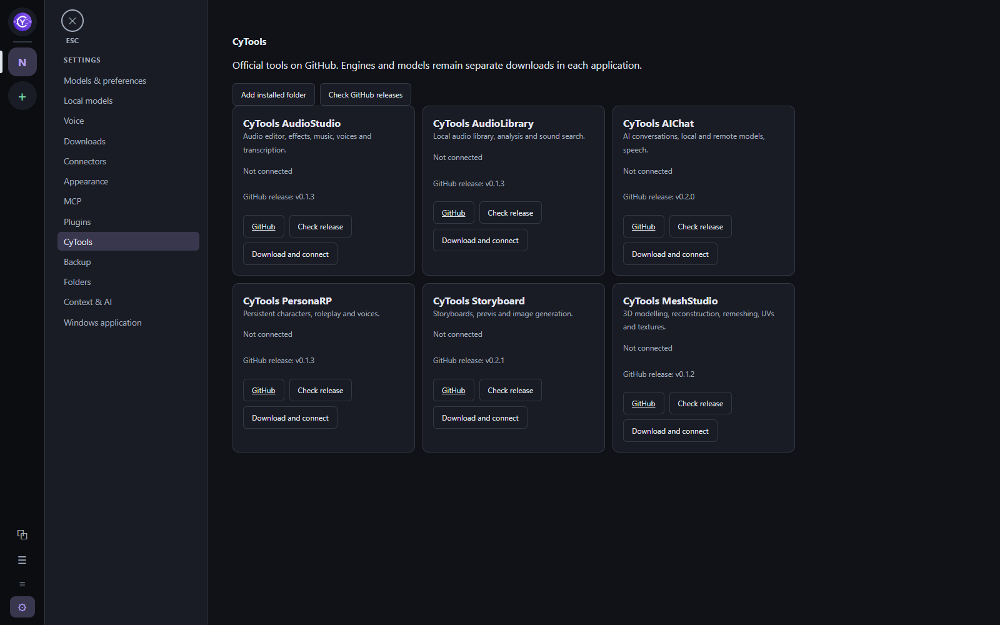

<p align="center">
  
</p>

# CyAI Orchestrator

A local Windows application for working with AI agents, conversations and background missions in one project workspace. CyAI combines a desktop interface, persistent SQLite history, provider connectors, local models and an MCP server.

The interface starts in **English**. **French** is also available under **Settings → Appearance → Interface language**. The choice is saved on this computer and applies to the web interface and Windows notification-area menu. Changing it preserves conversation drafts and does not stop background tasks. Model responses, user documents and project names keep their original language.

## Screenshots

A demonstration workspace with sample conversations and task data.

**Project conversations and team members**


<details>
<summary>Task board and CyTools catalogue</summary>

**Task assignments and review**


**Official CyTools catalogue**



</details>

## In-app documentation

Open **? Documentation** in the left rail, use Settings → Documentation, or press **F1** for help on the current panel. The bundled **CyDoc** reader opens in a separate window using local `file://` resources. It preserves the workspace and needs no server, CDN, Node.js or Internet connection for reading.

The 27 guide chapters are available in **English** (default) and **French**, with common page/section IDs, localized screenshots with zoom and in-window enlargement, static workflow diagrams and full-text search. Technical references, evaluation resources, historical notes and a bounded source index are also included. Preserved references awaiting translation are labelled with their original language. See the [documentation maintenance guide](docs/user-guide.md) for regeneration, translation tracking and platform scope.

## Windows desktop application

Build the desktop application with PowerShell:

```powershell
.\Build-Desktop.ps1
```

The application is created at `dist-next/CyAIOrchestrator/CyAIOrchestrator.exe`. Keep the complete directory, including `_internal`. Microsoft Edge WebView2 is required on Windows. The executable is not signed.

Start it with `Start-CyAI-Desktop.ps1`, or run the executable directly. To select an existing configuration:

```powershell
.\dist-next\CyAIOrchestrator\CyAIOrchestrator.exe --config C:\Projects\CyAIOrchestrator\config.json
```

Application data is stored separately from the program files. Closing the desktop window hides it in the Windows notification area; double-click the icon to reopen it. **Quit** stops the service started by this application, with confirmation if missions are active. A service started separately remains independent.

To produce the installer after building:

```powershell
python scripts/build_release.py
```

Installer outputs under `releases/` are release assets and are excluded from source control.

## Run from source

Requires Python 3.11 or later. From the repository root:

```powershell
python -m venv .venv
.\.venv\Scripts\python.exe -m pip install -e ".[desktop,claude]"
.\.venv\Scripts\python.exe -m cyai.desktop
```

To run just the local service and browser interface:

```powershell
.\.venv\Scripts\python.exe -m cyai
```

The default address is **http://127.0.0.1:8766**. Use `python -m cyai serve --no-browser` for manual browser launch. `Start-CyAI.ps1` uses `.venv` when present and otherwise the Python on `PATH`. Stop the service with `Ctrl+C`; closing its browser tab does not stop missions.

## Models and optional downloads

The desktop package includes the interface, Python and connector adapters. Large optional components are downloaded explicitly through **Settings → Local models**, **Voice** or **Downloads**, and stored in the user's data directory.

- **GGUF models:** download from Hugging Face or import an existing model. Configure the engine, GPU layers, threads and context size. The integrated engine uses llama.cpp; Ollama is also available as a separate connector.
- **Speech:** install the transcription engine, voice engine and models you need. Available integrations include Whisper, Phonon, Piper and other optional local engines. Hardware and language support depend on the selected engine.
- **Claude Code:** reuse an installed native CLI or download it from its official source under **Downloads → On-demand components**. The Python SDK is included in the desktop package; the large native CLI executable is downloaded separately. Sign in under **Connectors**.
- **CyAnnota video:** download the optional FFmpeg component from the same panel. Image and 3D features do not require it. Once downloaded, the codec loads from the local cache.

Installation and download buttons show queued/running operations and progress. Selecting a catalogue item does not itself download a model.

## Projects and conversations

Add a project by choosing an existing folder. Each project groups conversations, its assistant, shared memory, skills, team, media and enabled plugins. Independent direct messages have their own workspace and attachments.

Choose an agent and model in the composer. By default, **Enter** sends and **Shift+Enter** adds a new line; change this under **Settings → Context & AI**. You can send attachments without accompanying text.

While a response is running, new messages can wait in a queue. **Send now** interrupts the current response to send the queued message. **Stop** cancels the active response. Cancellation does not undo file changes already made by an agent.

Images and videos open in the application with a larger preview. Supported 3D formats open in the integrated viewer with camera controls, backgrounds, lighting presets and supported PBR materials. File context menus offer external opening, File Explorer and link copying. Unsupported formats can be opened with Windows.

The composer displays usage supplied by the connector. Context capacity and subscription quota are shown when available; an unknown limit is not presented as a measured one. Local-model controls also show configured context and available resource measurements.

## Orchestration and background work

An orchestrator conversation turns a goal into a dependency graph of tasks. Review the instructions, agent assignments, models and checks, then approve the plan. Independent branches may run concurrently; dependent tasks wait for successful prerequisites. The local inference engine runs one model request at a time.

Background evaluation batches use isolated workspaces without adding a visible conversation for every candidate. Progress remains available from the controlling conversation and logs. Background-work cards can be hidden.

The agent library stores reusable profiles and revisions. Project teams pin profile revisions and can define managers, leads, members and consultants. The task board records assignments, reports, reviews and acceptance decisions. A completed run or submitted report does not by itself prove that the requested work is correct.

## Provider connections

Configure and enable providers in **Settings → Connectors**. Available integrations include Codex, Claude Code, OpenCode, Anthropic API, OpenRouter, Ollama, the integrated local engine and additional native CLI adapters.

Native agents require their own installed CLI and authentication. API integrations require an API key and a supported model. **A ChatGPT or Claude app subscription does not automatically provide API credit.** Provider features vary; the interface distinguishes detected installations from verified connections.

Windows DPAPI stores supported credentials for the current Windows user. Enter keys in the connector's dedicated field. Do not put credentials in a project folder, committed configuration or documentation.

Permissions can be configured globally or per conversation. Automatic approval applies to supported tool requests within the configured scope; orchestration plans still require a launch decision. Unsupported native requests are reported. Review provider-specific limitations in [docs/connectors.md](docs/connectors.md).

## Memory, history and backups

Conversation messages, mission events, context references and session mappings persist in SQLite. Shared memory and skills provide explicit project context. Native agents retain their own provider-side sessions; changing the selected context can require a fresh session.

Search includes archived conversations. You can rename, archive, branch and export conversations. Branching copies message history, not project files, and does not revert filesystem changes.

Export or restore application backups in **Settings → Backup**. Portable backups do not include credentials, project working files or provider-native session storage. Back up project folders separately. For a complete local data-folder copy, stop the service first; DPAPI credentials remain tied to the Windows account.

## Plugins, CyTools and MCP

Configure plugins under **Settings → Plugins** and enable them per project. Only enabled plugins declaring a project view appear in project tabs. Standalone CyTools are listed separately under **Settings → CyTools**. The official catalogue now covers [AudioStudio](https://github.com/MrMybal/CyTools_AudioStudio), [AudioLibrary](https://github.com/MrMybal/CyTools_AudioLibrary), [AIChat](https://github.com/MrMybal/CyTools_AIChat), [PersonaRP](https://github.com/MrMybal/CyTools_PersonaRP), [Storyboard](https://github.com/MrMybal/CyTools_Storyboard) and [MeshStudio](https://github.com/MrMybal/CyTools_MeshStudio). Check their GitHub releases, then download and connect a verified Windows portable package, or add an already installed folder. Engines and model weights remain separate downloads managed by each tool. Previous registrations are preserved in a collapsed compatibility section.

The integrated [CyAnnota](https://github.com/MrMybal/CyAnnota) 0.4.4 and [CyMD](https://github.com/MrMybal/CyMD) 0.1.4 editors inherit the interface language and are supplied with their source archives and licence notices. [CyAICodex](https://github.com/MrMybal/CyAICodex) connects its current skills and image library through MCP. [CyTask](https://github.com/MrMybal/CyTask) connects projects, tasks, agents and durable calls through its bundled MCP bridge (requires Node.js 22 or later); enter the server URL and a CyTask agent or API token in its configuration. Tokens are stored in the Windows vault. Standalone Windows applications can be downloaded separately from their plugin cards. External plugins may manage their own interface language. See [docs/plugins.md](docs/plugins.md).

Register local MCP servers such as Blender under **Settings → MCP**, then expose them to the relevant projects or agents. A registered configuration identifies the server; a working connection still depends on the server and its software being available.

CyAI also exposes an MCP stdio bridge to its running local service. Generate client configuration under **Settings → MCP**, or adapt this command:

```powershell
codex mcp add cyai -- C:\Projects\CyAIOrchestrator\.venv\Scripts\python.exe C:\Projects\CyAIOrchestrator\scripts\mcp_bridge.py --project PROJECT_ID
```

The service must already be running. Each project ID scopes the client; read and write access follow the generated configuration. Launch tools return mission identifiers so clients can follow long-running work asynchronously.

## Configuration and diagnostics

Project folders can be registered through the interface without manually editing JSON. `config.example.json` is an optional starting point; copy it only if a configuration does not already exist.

Key settings include `port`, `data_dir`, `allowed_roots`, `context_chars`, provider connector settings and `settings.language` (`en` or `fr`, default `en`). The service binds to loopback. Manually edited settings may require a restart.

**Logs** contains the application journal, raw JSON, MCP operations, connector status and resource history. Available CPU, RAM, GPU and VRAM measurements appear over time; unavailable measurements remain marked as such.

## Development checks

```powershell
python -m unittest discover -s tests -v
node tests/i18n.cjs
node tests/help.cjs
node tests/ui-async-regressions.cjs
python scripts/check_repository.py --download-gitleaks
```

Repository-check reports are written under ignored `test-results/repository-check`. GitHub Actions runs repository checks on pushes and pull requests. Provider smoke scripts under `scripts/` use real connections and may consume quota; run them deliberately.

The shared translation catalogue is `cyai/locales/en.json`; French source messages are stable keys. Use `ui('…')` or tagged `ui` templates for application-owned interface text. Template values stay opaque and are inserted after translation. Add an English entry for each new source message, preserve numbered placeholders, and keep user content outside translation calls. See [docs/localization.md](docs/localization.md).

Architecture and implementation details: [docs/architecture.md](docs/architecture.md), [docs/connectors.md](docs/connectors.md) and [VALIDATION.md](VALIDATION.md).

## License

Copyright (C) 2026 MrMybal.

CyAI Orchestrator is free software licensed under the **GNU Affero General Public License, version 3 only** (`AGPL-3.0-only`). You may redistribute and modify it under those terms. It is provided without warranty; see [LICENSE](LICENSE) for the complete terms.

Third-party libraries, bundled plugins and downloadable models retain their respective licenses and notices.
