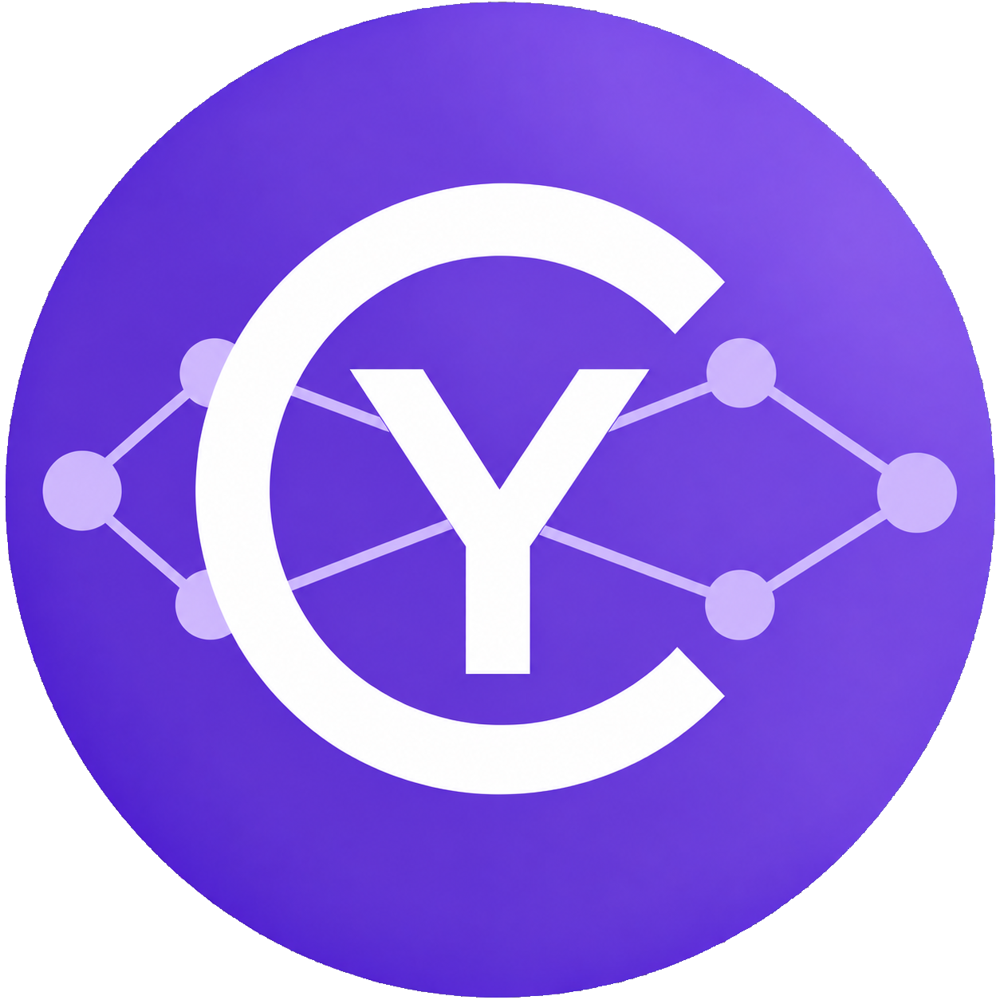
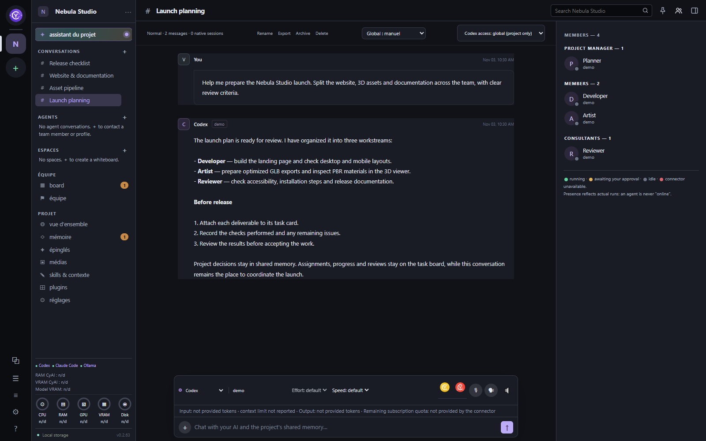
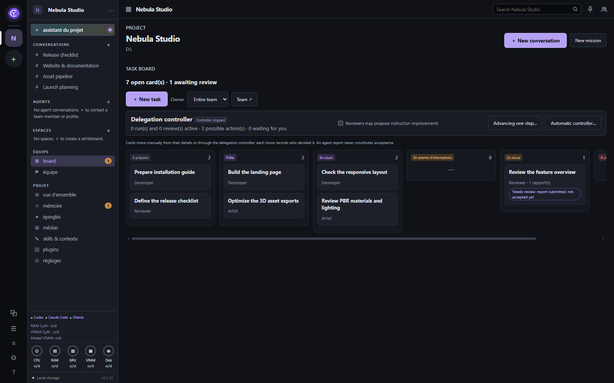
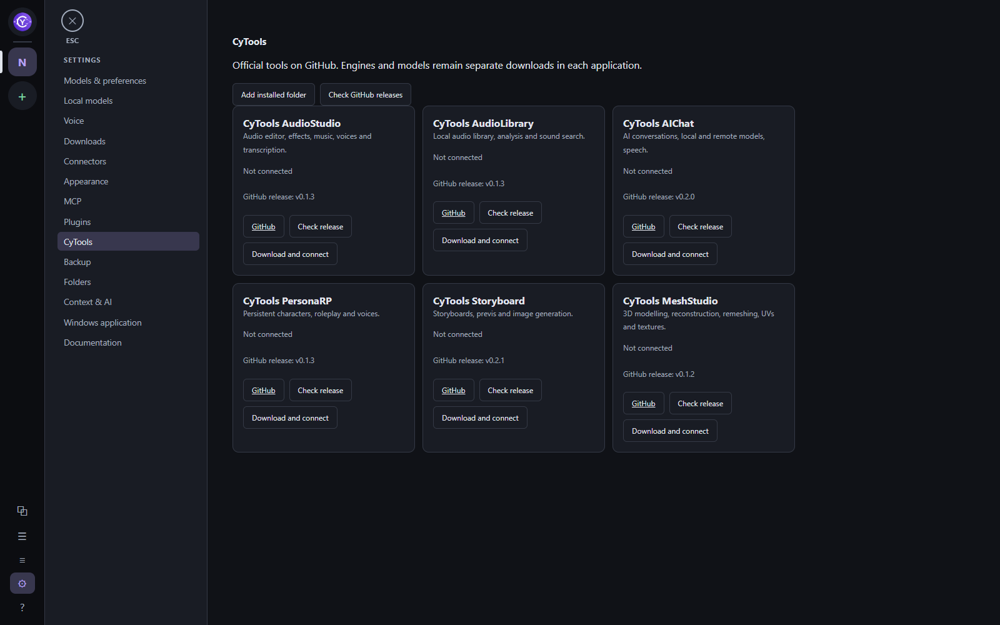

<table width="100%">
  <tr>
    <td width="300" align="left" valign="top">
      <a href="https://mrmybal.github.io/CyAIOrchestrator/Documentation.html#/en/start">Documentation</a><br>
      <a href="https://github.com/MrMybal/CyAIOrchestrator">Repository</a><br>
      <a href="https://github.com/MrMybal/CyAIOrchestrator/issues">Issue tracker</a><br><br>
      <sub>README</sub><br>
      <a href="README.md">English</a> · <a href="README.fr.md">Français</a>
    </td>
    <td width="400" align="center" valign="middle">
      
    </td>
    <td width="300" align="right" valign="top">
      <p><sub>Application license</sub><br><a href="LICENSE"><strong>AGPL-3.0-only</strong></a></p>
      <p><sub>Version</sub><br><a href="docs/release-0.2.66.md"><strong>0.2.66</strong></a><br><strong>Alpha</strong></p>
      <p><a href="https://github.com/MrMybal/CyAIOrchestrator/releases/download/v0.2.66/CyAIOrchestrator-Setup-0.2.66.exe"><strong>Download</strong></a><br><sub>Windows x64 · installer</sub></p>
    </td>
  </tr>
</table>

<h1 align="center">CyAI Orchestrator</h1>

A local Windows workspace for people working with AI agents on project files. Bring conversations, reusable agents, shared context, task boards and background missions together, using provider connectors or local models.

> **Alpha · 0.2.66**
>
> Intended for testing and feedback. Features may be incomplete and workflows may change before a stable release. Read the [version notes and documented limitations](docs/release-0.2.66.md), or [report an issue](https://github.com/MrMybal/CyAIOrchestrator/issues).

[](Documentation/DocData/assets/images/conversation-en.png)

## Work in one project workspace

Add an existing project folder, connect an AI provider or load a local model, then work from a conversation. Projects group their assistant, conversations, shared memory, skills, team, media and enabled plugins. The interface starts in **English**; **French** is available under **Settings → Appearance → Interface language**. Switching languages preserves drafts and does not stop background work. User documents, model responses and project names retain their original language.

Use an orchestrator conversation to prepare a dependency graph of tasks, review its instructions and assignments, then approve the plan. Independent branches can run concurrently; dependent tasks wait for successful prerequisites. The agent library stores reusable profiles and revisions, while the task board records assignments, reports, reviews and acceptance. Background evaluation batches use isolated workspaces without creating a visible conversation for every candidate. The integrated local inference engine handles one model request at a time.

<details>
<summary>See the task board and CyTools catalogue</summary>

**Assignments and review**

[](Documentation/DocData/assets/images/task-board-en.png)

**Tools installed separately**

[](Documentation/DocData/assets/images/cytools-en.png)

</details>

## Features

- **Conversations and files:** send text or attachments alone, queue messages during a response, or use **Send now** to interrupt and send immediately. Open images and videos in the app, and inspect supported 3D files with backgrounds, lighting presets and PBR materials. File menus offer external opening, File Explorer and path copying.
- **Provider connections:** integrations include Codex, Claude Code, OpenCode, Anthropic API, OpenRouter, Ollama and the integrated local engine. Installations, authentication and available capabilities depend on each connector. Usage, context capacity and subscription quota appear when the connector supplies them.
- **Local models and voice:** download or import GGUF models, configure their context and engine, and install optional dictation or speech engines such as Whisper, Phonon or Piper. Engines, model weights and hardware requirements are separate from the desktop installer.
- **Persistent context:** SQLite stores conversation history and mission events. Shared memory and skills provide explicit project context. Search, archives, branching, export and application backups are available; project files and provider-native sessions need their own backups.
- **Plugins and CyTools:** configure extensions globally and enable them per project. Only enabled plugins with a project view become tabs. CyTools have a separate catalogue. Embedded CyAnnota and CyMD editors, CyAICodex and CyTask integrations extend the workspace; see the [plugin reference](docs/plugins.md).
- **MCP and diagnostics:** register local MCP servers, expose them to selected projects or agents, and generate configuration for CyAI's own scoped MCP bridge. **Logs** groups the journal, raw events, MCP operations, connector status and available CPU, RAM, GPU and VRAM history.
- **Local bilingual help:** press **F1**, select **? Documentation** in the left rail, or open **Settings → Documentation**. The CyDoc reader opens in its own window with search, screenshots, diagrams, themes and in-window image zoom. Its complete English and French editions work offline; the [online manual](https://mrmybal.github.io/CyAIOrchestrator/Documentation.html#/en/start) uses the same reader.

---

## Installation

The published desktop installer is for **Windows x64**. It includes the application and its Python runtime. [Microsoft Edge WebView2 Runtime](https://developer.microsoft.com/en-us/microsoft-edge/webview2/#download-section) must be available; the installer executable is not digitally signed. There is no published Linux or macOS installer for this release.

1. [Download CyAI Orchestrator 0.2.66](https://github.com/MrMybal/CyAIOrchestrator/releases/download/v0.2.66/CyAIOrchestrator-Setup-0.2.66.exe). The [release page](https://github.com/MrMybal/CyAIOrchestrator/releases/tag/v0.2.66) also provides the SHA-256 checksum.
2. Run the installer for your Windows account, then start **CyAI Orchestrator** from its shortcut. Updates retain the existing configuration and previous installed version. Application data is stored separately from program files.
3. Open **Settings → Connectors** to configure a provider, or **Settings → Local models** to download or import a model. Native agents require their own CLI and authentication; API providers require credentials and API credit. A ChatGPT or Claude app subscription does not automatically include API credit.
4. Add an existing project folder and start a conversation. Set the interface language under **Settings → Appearance** if needed.

Large weights and optional engines are downloaded explicitly through **Local models**, **Voice** or **Downloads**. The native Claude Code CLI and CyAnnota's optional FFmpeg component are separate downloads. External CyTools manage their own engines and models. Selecting a catalogue item does not itself start a download; no single GPU or VRAM requirement covers every model.

Closing the window hides the app in the Windows notification area. Double-click its icon to reopen it; **Quit** stops the service started by that instance. A separately started service remains independent. Stopping an agent does not undo file changes it has already made. Portable application backups exclude credentials, project working files and native provider sessions: back up project folders separately.

## Source, build and required libraries

<details>
<summary>Build on Windows or run from source</summary>

Use **Python 3.11+**, **Git**, PowerShell, and **Node.js 22+ with npm** for documentation generation. The desktop build creates its own `.desktop-venv`, installs the Python dependencies, generates the local manual and packages with PyInstaller. The local service uses `jsonschema`; the desktop uses `pywebview`. Node.js is not required to read the generated manual or run the core desktop app; the optional CyTask MCP bridge requires Node.js 22+.

```powershell
git clone https://github.com/MrMybal/CyAIOrchestrator.git
cd CyAIOrchestrator
.\Build-Desktop.ps1
.\dist-next\CyAIOrchestrator\CyAIOrchestrator.exe
```

Keep the complete `dist-next/CyAIOrchestrator` directory, including `_internal`. To produce an installer after building:

```powershell
.\.desktop-venv\Scripts\python.exe scripts/build_release.py
```

To run from source instead:

```powershell
python -m venv .venv
.\.venv\Scripts\python.exe -m pip install -e ".[desktop,claude]"
.\.venv\Scripts\python.exe -m cyai.desktop
```

The `claude` extra installs the small Python SDK, not the separately downloaded native CLI. To run only the local service and browser interface, use `.\.venv\Scripts\python.exe -m cyai`. The default address is `http://127.0.0.1:8766`; stop it with **Ctrl+C**. Closing its browser tab does not stop missions.

Register folders through the interface. Use `config.example.json` only as a starting point when no configuration exists. An existing configuration can be selected with `--config C:\Projects\CyAIOrchestrator\config.json`. Credentials belong in dedicated connector fields, not project files. See [connectors](docs/connectors.md), [localization](docs/localization.md) and [architecture](docs/architecture.md) for contributor details.

To regenerate the bundled manual:

```powershell
python scripts/build_documentation.py --install
python scripts/build_documentation.py --check
```

Distribute the entire `Documentation/` directory. Open `Documentation/Documentation.html` directly via `file://`; reading needs no server, CDN or Internet connection. The authoring workspace is `.CyDocBuild/` and is not part of the reader.

To build and preview the standalone bilingual showcase (Node.js 22+):

```powershell
node website/build.mjs
node website/preview.mjs
```

The output is `dist/website/index.html`, with the complete local manual. See the [showcase build guide](website/README.md) for capture sources and preview commands.

</details>

---

## License

Copyright (C) 2026 MrMybal.

CyAI Orchestrator is licensed under the **[GNU Affero General Public License, version 3 only](LICENSE)** (`AGPL-3.0-only`). You may redistribute and modify it under those terms. It is provided without warranty. Third-party components and separately downloaded tools or models retain their own terms.

### Main third-party components

| Library · source | License · terms | Use / scope |
| --- | --- | --- |
| [CPython](https://github.com/python/cpython) | [PSF license and component notices](https://github.com/python/cpython/blob/3.11/LICENSE) | Python runtime included in the Windows package; Python 3.11+ for source builds. |
| [jsonschema](https://github.com/python-jsonschema/jsonschema) | [MIT](https://github.com/python-jsonschema/jsonschema/blob/main/COPYING) | Local service: configuration and structured-data validation. |
| [pywebview](https://github.com/r0x0r/pywebview) | [BSD-3-Clause](https://github.com/r0x0r/pywebview/blob/master/LICENSE) | Desktop window and native bridge. |
| [pythonnet](https://github.com/pythonnet/pythonnet) | [MIT](https://github.com/pythonnet/pythonnet/blob/master/LICENSE) | Windows .NET bridge used by pywebview. |
| [Microsoft WebView2 Runtime](https://developer.microsoft.com/en-us/microsoft-edge/webview2/) | [Microsoft runtime terms and component notices](https://developer.microsoft.com/en-us/microsoft-edge/webview2/#download-section) | Separately installed Windows web runtime; terms shown with the runtime download. |
| [Claude Agent SDK for Python](https://github.com/anthropics/claude-agent-sdk-python) | [MIT](https://github.com/anthropics/claude-agent-sdk-python/blob/main/LICENSE) | Optional provider adapter. The native Claude Code CLI has separate terms and authentication. |
| [Three.js](https://github.com/mrdoob/three.js) | [MIT notice](cyai/web/three/LICENSE.txt) | Application's 3D viewer, r180; not a documentation dependency. |
| [CyAnnota](https://github.com/MrMybal/CyAnnota) | [AGPL-3.0-only](cyai/web/cyannota/LICENSE.txt) · [component notices](cyai/web/cyannota/THIRD_PARTY_NOTICES.md) | Embedded image and 3D editor, 0.4.4. Its web bundle includes MIT components such as React, Next.js, Three.js and JSZip (MIT option). |
| [FFmpeg WebAssembly](https://github.com/ffmpegwasm/ffmpeg.wasm) | [CyAnnota component notices](cyai/web/cyannota/THIRD_PARTY_NOTICES.md): core GPL-2.0-or-later; wrapper MIT | Optional CyAnnota video codec, downloaded on demand; not included in the installer. |
| [CyMD](https://github.com/MrMybal/CyMD) | [AGPL-3.0-only](cyai/web/cymd/LICENSE.txt) | Embedded document editor, 0.1.4, with its source archive and notices. |
| [CyTask SDK / MCP](https://github.com/MrMybal/CyTask) | [AGPL-3.0-only](cyai/integrations/cytask/LICENSE) | Bundled integration; optional MCP bridge needs Node.js 22+. |
| [CyDoc](https://github.com/MrMybal/CyDoc) | [MIT notice](Documentation/DocData/CyDoc-LICENSE.txt) | Local manual generator and distributed reader. Only the image media module is enabled. |
| [Marked](https://github.com/markedjs/marked) | [MIT](https://github.com/markedjs/marked/blob/master/LICENSE) | Documentation Markdown compilation. |
| [PrismJS](https://github.com/PrismJS/prism) | [MIT](https://github.com/PrismJS/prism/blob/master/LICENSE) | Documentation code highlighting. |
| [esbuild](https://github.com/evanw/esbuild) | [MIT](https://github.com/evanw/esbuild/blob/main/LICENSE.md) | Documentation build tool; not required to read the export. |
| [Node.js](https://github.com/nodejs/node) | [MIT and third-party notices](https://github.com/nodejs/node/blob/main/LICENSE) | Documentation build and optional CyTask bridge; separate installation. |
| [PyInstaller](https://github.com/pyinstaller/pyinstaller) | [GPL-2.0-or-later with bootloader exception](https://github.com/pyinstaller/pyinstaller/blob/v6.22.3/COPYING.txt) | Windows packaging tool, 6.22.3; the exception permits distributing the packaged app under its own license. |

This table indexes the main components and their scope; it does not replace the complete transitive notices. Retain the license texts, component notices and editor source archives supplied with the application. Check the terms of optional engines, models and external tools before installing them.

## References and links

- [Documentation](https://mrmybal.github.io/CyAIOrchestrator/#/en/start) — the published HTML reader, also bundled for offline use.
- [French README](README.fr.md) · [Version notes](docs/release-0.2.66.md)
- [Source repository](https://github.com/MrMybal/CyAIOrchestrator) · [Releases](https://github.com/MrMybal/CyAIOrchestrator/releases) · [Issue tracker](https://github.com/MrMybal/CyAIOrchestrator/issues)
- [Connector reference](docs/connectors.md) · [Plugin reference](docs/plugins.md) · [Localization guide](docs/localization.md)
